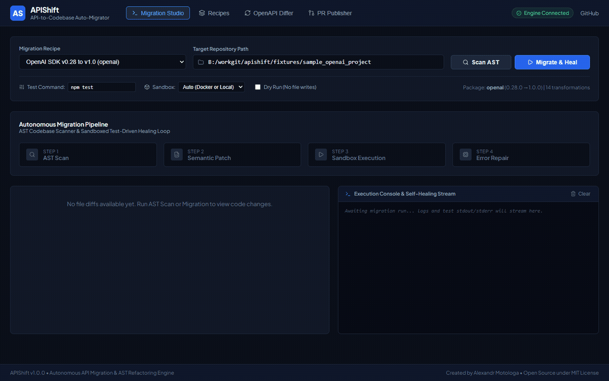
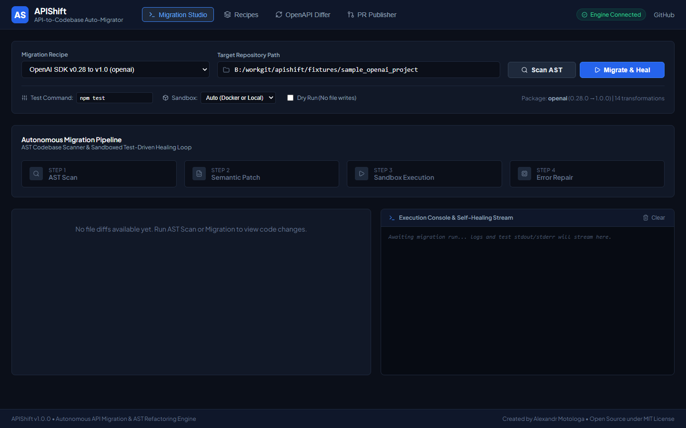
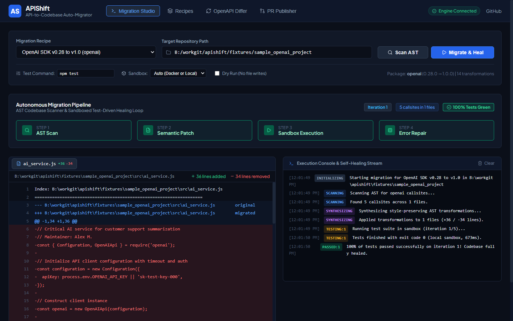
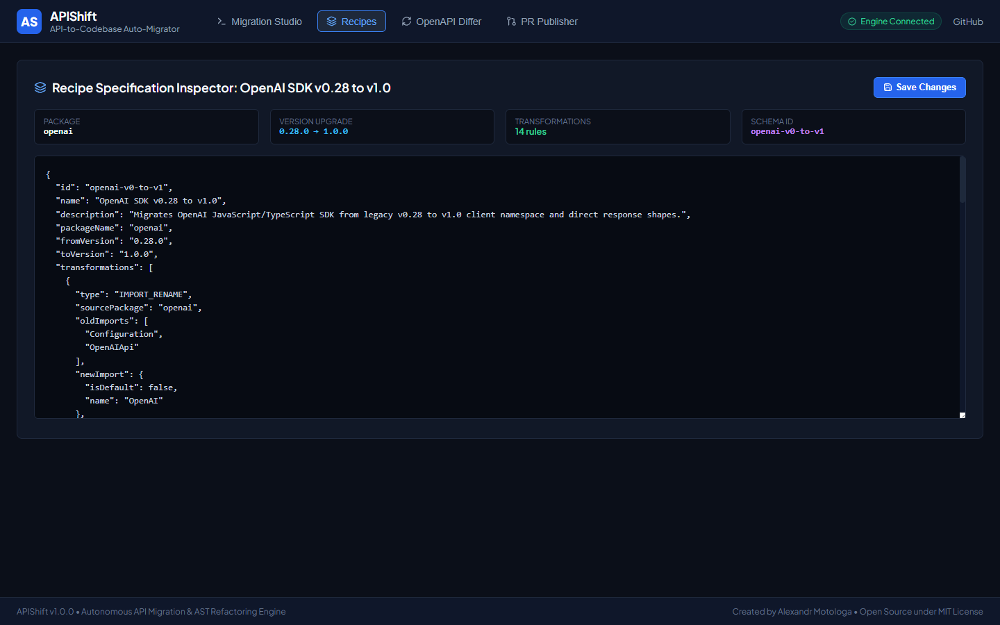
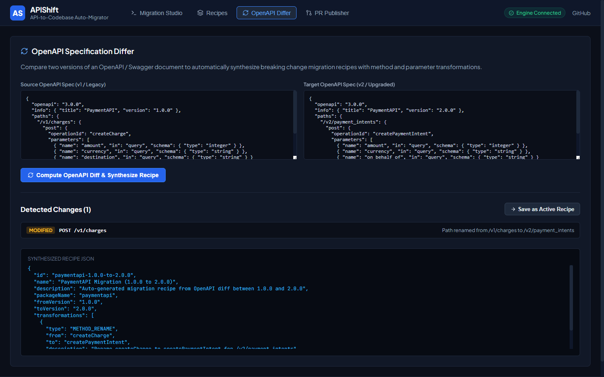

<p align="center">
  
</p>

<h1 align="center">APIShift</h1>

<p align="center">
  <strong>Autonomous API-to-Codebase Migration and Self-Healing AST Engine</strong>
</p>

<p align="center">
  <a href="https://github.com/alexandrmotologa/apishift/actions"></a>
  <a href="https://github.com/alexandrmotologa/apishift/blob/main/LICENSE"></a>
  <a href="https://www.typescriptlang.org/"></a>
  <a href="https://react.dev/"></a>
</p>

Autonomous API migration and breaking change healing engine. Ingests API breaking change specifications and SDK migration guides, scans repository Abstract Syntax Trees (ASTs), synthesizes type-safe code transformations, runs local test suites in isolated sandboxes, and iteratively heals regressions until 100% of tests pass.



---

## What it does

Software teams frequently postpone major SDK upgrades because manual refactoring across hundreds of files introduces high regression risks. Passing entire repositories to standard chat models often generates broken parameter names or deletes unrelated logic.

APIShift automates the complete upgrade lifecycle:
1. **Migration recipe ingestion**: loads declarative migration recipes (OpenAI v0.28 to v1.0, Stripe v12 to v14, Supabase v1 to v2, Next.js Pages to App Router) or computes OpenAPI diffs between two versions.
2. **AST codebase scanner**: walks TypeScript, JavaScript, and Python ASTs using Babel and Recast, mapping every import statement, class instantiation, method call, and parameter dictionary.
3. **Semantic patch synthesizer**: performs style-preserving AST mutations, retaining existing user comments, indentation, and structure.
4. **Manifest auto-upgrade**: automatically detects and upgrades dependency constraints in `package.json`, `requirements.txt`, or `pyproject.toml`.
5. **Sandboxed test-driven healing loop**: executes the repository test suite in an isolated sandbox (Docker container when available, or an isolated process runner). Parses compiler errors and assertion failures, applying iterative repairs until all tests turn green.
6. **Snapshotting & instant rollback**: takes atomic pre-migration snapshots of affected files, offering safe rollbacks if regressions cannot be healed.
7. **Selective cherry-pick & visual recipe builder**: interactive Web Studio interface with live playgrounds, file selection checkboxes, and OpenAPI diffing.
8. **Pull request publisher & audit reports**: creates dedicated migration branches, writes conventional git commits, generates `APISHIFT_MIGRATION_REPORT.md`, and opens verified GitHub pull requests.

---

## Visual walkthrough

| Migration studio & live test console | Side by side diff viewer |
| :---: | :---: |
|  |  |

| Recipe inspector & schema editor | OpenAPI specification differ |
| :---: | :---: |
|  |  |

---

## Installation

```bash
# Clone the repository
git clone https://github.com/alexandrmotologa/apishift.git
cd apishift

# Install dependencies and build
npm install
npm run build:all
```

---

## CLI usage

### 1. List available built-in recipes
```bash
node dist/cli.js recipes
```

### 2. Scan a target repository
Finds all callsites matching a migration recipe without modifying files:
```bash
node dist/cli.js scan --repo ./my-project --recipe openai-v0-to-v1
```

### 3. Run migration with test healing
Applies AST transformations, auto-updates manifests, and verifies against your project test suite:
```bash
node dist/cli.js migrate --repo ./my-project --recipe openai-v0-to-v1 --test-cmd "npm test"
```

Advanced migration flags:
- `--sandbox <mode>`: sandbox runner mode (`auto`, `docker`, or `local`, default: `auto`).
- `--test-cmd <cmd>`: test command to execute (e.g., `npm test`, `npx vitest run`, `node --test`, `pytest`).
- `--rollback-on-failure`: automatically reverts all modified files if tests fail to heal.
- `--no-manifest-upgrade`: prevents updating `package.json` or `requirements.txt`.
- `--no-report`: skips generating `APISHIFT_MIGRATION_REPORT.md`.
- `--dry-run`: previews changes without writing files to disk.
- `--auto-pr`: creates a git branch, commits changes, and opens a GitHub pull request.
- `--max-iter <num>`: maximum self-healing iterations (default: 5).

### 4. Rollback to latest snapshot
Restores all modified files to their clean pre-migration state:
```bash
node dist/cli.js rollback
```

### 5. Diff two OpenAPI specifications
Compares two OpenAPI JSON/YAML specifications and generates an automated migration recipe:
```bash
node dist/cli.js diff --spec-old ./spec-v1.json --spec-new ./spec-v2.json --out ./custom-recipe.json
```

### 6. Start the web review studio
Launches the Fastify API server and React 19 web studio on port 9220:
```bash
node dist/cli.js serve --port 9220
```

Open `http://localhost:9220` in your browser.

---

## GitHub Action integration

You can run APIShift directly in GitHub Actions pipelines using `alexandrmotologa/apishift@v1`:

```yaml
name: API Migration & Verification

on:
  workflow_dispatch:
    inputs:
      recipe:
        description: 'Migration recipe ID'
        required: true
        default: 'openai-v0-to-v1'

jobs:
  migrate:
    runs-on: ubuntu-latest
    steps:
      - uses: actions/checkout@v4

      - name: Run APIShift
        uses: alexandrmotologa/apishift@v1
        with:
          recipe: ${{ github.event.inputs.recipe }}
          test-command: 'npm test'
          auto-pr: 'true'
          github-token: ${{ secrets.GITHUB_TOKEN }}
```

### Action inputs

| Input | Description | Required | Default |
| :--- | :--- | :--- | :--- |
| `recipe` | Migration recipe ID (e.g. `openai-v0-to-v1`, `stripe-v12-to-v14`) or path to custom recipe JSON | Yes | &mdash; |
| `repo-path` | Target repository path to scan and migrate | No | `.` |
| `test-command` | Test suite command to execute inside sandbox | No | `npm test` |
| `sandbox-mode` | Sandbox runner mode (`auto`, `docker`, or `local`) | No | `auto` |
| `auto-pr` | Automatically create a branch, commit, and open a verified GitHub PR | No | `false` |
| `github-token` | GitHub token for opening pull requests (`contents:write`, `pull-requests:write`) | No | `${{ github.token }}` |

---

## Pre-packaged migration recipes

| Recipe ID | Target package | Version jump | Description |
| :--- | :--- | :--- | :--- |
| `openai-v0-to-v1` | `openai` | `0.28.0` → `1.0.0` | Migrates `Configuration` and `OpenAIApi` to `OpenAI`, renames `createChatCompletion` to `chat.completions.create`, updates `model_name` to `model`, and removes `.data` wrapper. |
| `stripe-v12-to-v14` | `stripe` | `12.0.0` → `14.0.0` | Migrates `charges.create` to `paymentIntents.create`, remaps `destination` to `on_behalf_of`, and wraps options into secondary parameters. |
| `supabase-v1-to-v2` | `@supabase/supabase-js` | `1.35.0` → `2.0.0` | Migrates synchronous `auth.user()` and `auth.session()` calls to asynchronous `auth.getUser()` and `auth.getSession()`. |
| `nextjs-pages-to-app` | `next` | `12.0.0` → `14.0.0` | Updates `useRouter` import path from `next/router` to `next/navigation` and flags legacy query parameters. |
| `aws-sdk-v2-to-v3` | `aws-sdk` | `2.1000.0` → `3.0.0` | Migrates AWS SDK v2 monolithic client usage to modular AWS SDK v3 client packages (`@aws-sdk/client-s3`) and command executions. |
| `langchain-v0-to-v1` | `langchain` | `0.1.0` → `0.2.0` | Migrates legacy monolithic LangChain imports to modular `@langchain/openai` and `@langchain/core` packages. |

---

## Architecture

```
apishift/
├── src/
│   ├── spec/            # Recipe parser and OpenAPI differ
│   ├── scanner/         # Babel / Recast AST visitor, Python scanner, and import resolver
│   ├── synthesizer/     # Style-preserving AST mutator, manifest updater, and patch generator
│   ├── sandbox/         # Dockerode runner and local process sandbox
│   ├── agent/           # Test-driven self-healing loop, snapshot engine, and LLM fallback
│   ├── git/             # Branch manager, report generator, and GitHub PR publisher
│   ├── server/          # Fastify backend and Server-Sent Events stream
│   └── cli.ts           # Commander CLI entrypoint
├── web/                 # React 19 web review studio (Vite, TypeScript, CSS)
├── fixtures/            # Real sample project fixtures for verification (Node.js & Python)
├── action.yml           # Reusable GitHub Action specification
└── tests/               # Vitest unit and integration test suite
```

---

## Verification and testing

Run the full automated test suite:
```bash
npm test
```

Expected output:
```text
 ✓ tests/snapshot.test.ts (1 test)
 ✓ tests/manifest_updater.test.ts (2 tests)
 ✓ tests/spec_ingestor.test.ts (3 tests)
 ✓ tests/report_generator.test.ts (1 test)
 ✓ tests/ast_walker.test.ts (1 test)
 ✓ tests/ast_mutator.test.ts (1 test)
 ✓ tests/error_parser.test.ts (2 tests)
 ✓ tests/python_scanner.test.ts (1 test)
 ✓ tests/openapi_differ.test.ts (1 test)
 ✓ tests/python_fixture_migration.test.ts (1 test)
 ✓ tests/healing_loop.test.ts (1 test)

 Test Files  11 passed (11)
      Tests  15 passed (15)
```

---

## License

MIT License. Copyright (c) 2026 Alexandr Motologa.
